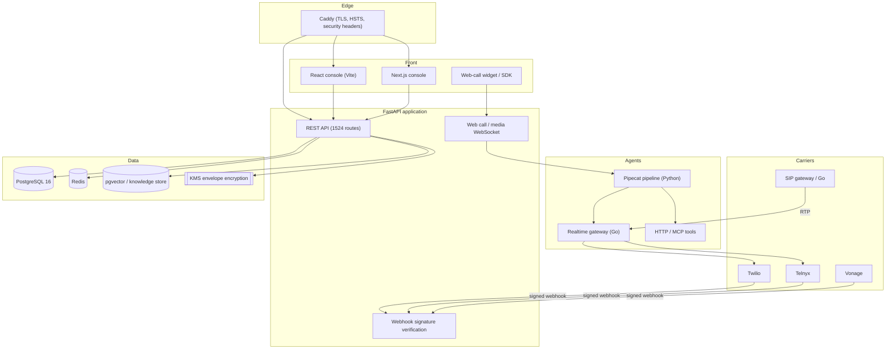

# VoxDesk

Multi-tenant AI voice-agent platform: inbound and outbound telephony, a
conversation-flow builder, RAG knowledge bases, CRM/helpdesk write-back, and a
React operator console, behind a single FastAPI application.

The status of every capability is generated, not asserted: see
[docs/SALES/FEATURE_MATRIX_VERIFIED.md](docs/SALES/FEATURE_MATRIX_VERIFIED.md).

## Architecture



## Measured repository statistics

Generated by `python scripts/repo_stats.py --write-readme`. Physical source lines
exclude generated/vendor/build trees; collected tests are not passed tests.

```json
{
  "source_files": 2082,
  "source_physical_lines": 424487,
  "registered_routes": 1524,
  "collected_pytest_nodes": 6738,
  "passed_tests": "not measured by collection"
}
```

## Feature status at a glance

Read from the generated matrix, never typed by hand. Regenerate with
`python scripts/generate_feature_matrix.py`.

| Status | Features | Meaning |
|---|---|---|
| LIVE | 38 | exercised end to end by the automated suite, without a live provider account |
| API_ONLY | 1 | implemented and routed, not exercised end to end |
| NOT_CONFIGURED | 1 | correctly refuses to operate until the buyer supplies credentials |
| PLANNED | 1 | not implemented |
| **Total** | **41** | |

## Quickstart

```sh
python3.12 -m venv .venv && . .venv/bin/activate
pip install -r requirements.txt -r requirements-test.txt
cp .env.example .env          # then fill in real secrets; the app refuses weak ones
make up                       # postgres + redis
make migrate                  # alembic upgrade head
python -m scripts.create_owner --help
uvicorn app.main:app --reload
```

The application refuses to boot with a default or short JWT secret, and in
production it also requires an https `PUBLIC_BASE_URL`, a webhook signature
secret, and E2E mode off. Those checks are enforced by
`tests/security/test_boot_secret_policy.py`.

## Tests and evidence

| Command | What it produces |
|---|---|
| `python scripts/pytest_chunks.py` | runs the whole population in chunks, JUnit per chunk |
| `python scripts/reconcile_validation_results.py --ci` | fails when collected != recorded; writes `reports/TEST_EVIDENCE_SUMMARY.json` |
| `make staging-proof` | `evidence/staging/<date>/staging_proof.json` from a real `docker compose up --build` |
| `python scripts/live_evidence_run.py --list` | opt-in, cost-guarded live-provider checks -> `evidence/live/*.json` |
| `make polyglot-evidence` | `reports/POLYGLOT_EVIDENCE_SUMMARY.json` for Go, Rust and C++ services |
| `make security-evidence` | `reports/SECURITY_EVIDENCE_SUMMARY.json` |
| `bash scripts/verify_deploy_assets.sh` | validates Helm, Terraform and Caddy for real |
| `make verify-truth` | every number quoted in the docs equals the code |
| `make verify-hygiene` | no generated artifact is tracked by git |

## Frontends

* `dashboard/` (Vite + React 18) is the **canonical production operator console**
  built into `Dockerfile` and served by FastAPI/Caddy in `docker-compose.prod.yml`
  and `infra/helm/voxdesk`.
* `dashboard-next/` (Next.js 14 App Router) is an **experimental, opt-in shadow
  console** (`dashboard-next/README.md`) validated in CI (`npm test`,
  `tsc --noEmit`, `next build`) and not deployed by default in production compose
  or Helm manifests.

## Deployment

* Single host: `docker compose -f docker-compose.prod.yml up --build`
  (Caddy terminates TLS; Postgres and Redis publish no host port).
* Kubernetes: `infra/helm/voxdesk` with `values-prod.yaml` or
  `values-staging.yaml`; validated by `helm lint`, `helm template` and
  `kubeconform`.
* Cloud: `infra/terraform` modules, validated with `fmt -check`, `validate`
  and `tflint`.

Step-by-step instructions for a buyer's team are in
[docs/BUYER_DEPLOY_GUIDE.md](docs/BUYER_DEPLOY_GUIDE.md). Security controls and
the evidence behind them are in [docs/SECURITY_POSTURE.md](docs/SECURITY_POSTURE.md).

## Repository hygiene

The repository tracks source, not output. `bash scripts/repo_cleanup.sh` (dry run
by default, `--apply` to act) untracks logs, archives and oversized generated
files and moves historical reports into `docs/archive/history/`. CI fails if any
of them come back.

## License and handoff

Commercial source-available licence; see `THIRD_PARTY_LICENSES.md` for bundled
dependencies. On handover the buyer receives this repository, the runbooks under
`docs/`, and the evidence generation scripts -- every claim in the sales material
can be regenerated from a clean clone.
